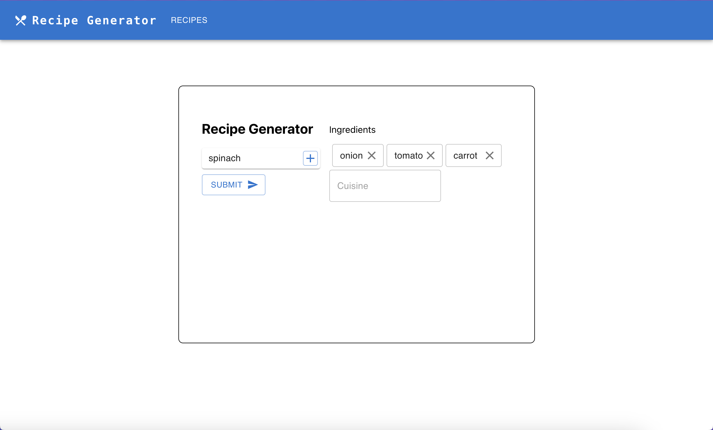
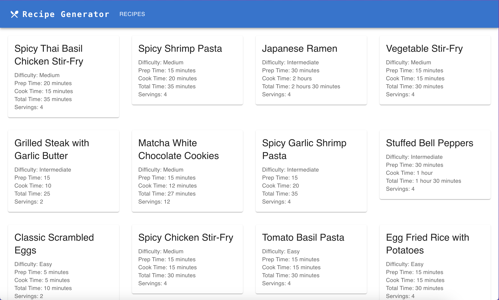
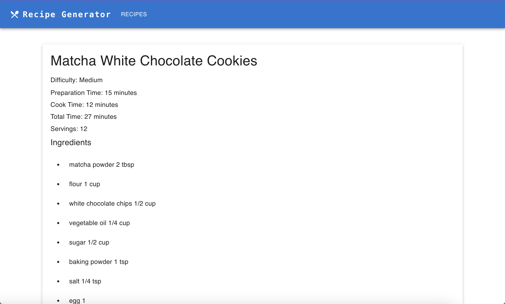

<!-- <a id="readme-top"></a>

<!-- PROJECT LOGO -->
<br />
<div align="center">
<h1 align="center">GPT-3.5 Recipe Generator</h3>

  <p align="center">
    A simple web application that allows users to generate a recipe based on user-inputted ingredients
    <br />
    <!-- <a href="https://github.com/github_username/repo_name"><strong>Explore the docs »</strong></a> -->
    <br />
    <br />
  </p>
</div>





### Built With

- [React.js](https://react.dev/)
- [MaterialUI](https://mui.com/material-ui/)
- [MongoDB](https://www.mongodb.com/)
- [GPT-3.5 Turbo](https://platform.openai.com/docs/models)

<p align="right">(<a href="#readme-top">back to top</a>)</p>

<!-- GETTING STARTED -->

## Getting Started

### Prerequisites

1. Create a .env file in the backend directory
2. Get an OpenAI API Key [here](https://platform.openai.com/docs/overview)
3. Create a MongoDB server (Not required for recipe generation)
4. Paste OpenAI API Key and MongoDB server conneciton string in the .env file in the same format provided in .env.sample
   ```sh
   API_KEY="INSERT_API_KEY_HERE"
   MONGODB_SERVER="INSERT_MONGODB_CONNECTION_STRING_HERE"
   ```

### How to Run

1. Navigate to the frontend and backend directory. Run the following in both directories

   ```sh
   npm install
   ```

2. Run the following in both frontend and backend directores
   ```sh
   npm start
   ```
